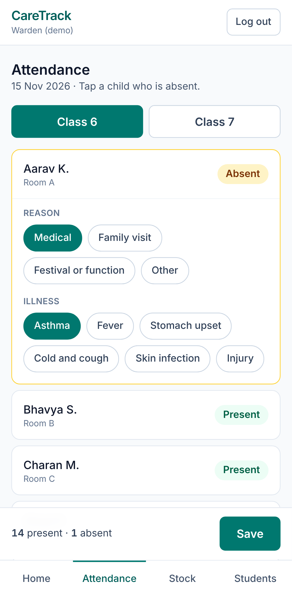
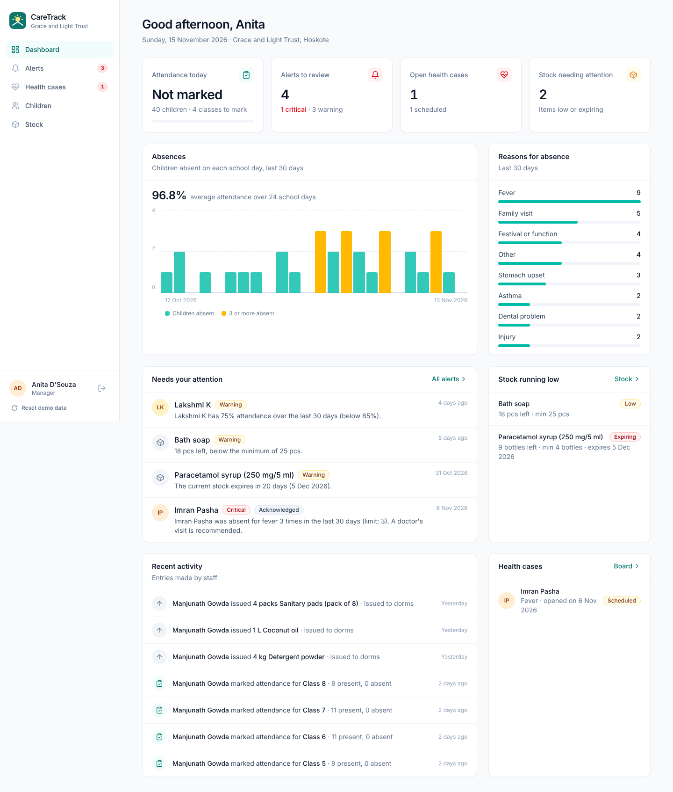

# CareTrack

A child attendance, health and stock tracking system for **Grace and Light
Trust**, a children's home in Hoskote, Karnataka.

Service Learning Project, team of five. There is **no AI or machine learning**
in the product: alerts come from three simple, fixed rules.

## What it does

The **warden** opens CareTrack on a phone and records the day's school
attendance (with the reason for each absence) and what stock was used. The
**manager** opens it on a laptop and sees a dashboard: who is missing school
and why, which children have been ill repeatedly, and which supplies are
running low. Three fixed rules raise alerts automatically, for example "absent
for asthma 3 times in 30 days", and the manager follows each health case until
it is resolved.

| Warden (phone) | Manager (laptop) |
|---|---|
|  |  |

More screenshots are in [docs/screenshots/](docs/screenshots/). All data shown is invented.

## Run it

You need [Node.js](https://nodejs.org) 22 (LTS). Then, in this folder:

```bash
npm install        # once
npm run build      # once, and again after any code change
npm start          # starts the app on http://localhost:3000
```

The database is created automatically on first start, filled with invented
demo data.

| Login | Username | Password |
|---|---|---|
| Manager | `manager` | `manager123` |
| Warden | `warden` | `warden123` |

**To use the warden screens on a real phone:** connect the phone to the same
Wi-Fi as the laptop, find the laptop's IP address (`ipconfig` on Windows,
`ifconfig` on Mac/Linux), and open `http://<that-address>:3000` on the phone.

Other commands:

| Command | What it does |
|---|---|
| `npm run dev` | Development mode with live reload (use on the laptop only) |
| `npm test` | Runs the 43 tests for the rules and the database constraints |
| `npm run db:reset` | Puts the demo data back to its starting state |
| `npm run lint` | Checks the code style |

The manager's dashboard also has a **Reset demo data** button, which does the
same as `npm run db:reset`. Use it before every rehearsal and before the demo.

## Start here

| If you want to... | Read |
|---|---|
| Understand the whole project | [docs/PROJECT_OVERVIEW.md](docs/PROJECT_OVERVIEW.md) |
| Know what you own and which files to read | [docs/ROLES.md](docs/ROLES.md) |
| Know what to say in the demo, and the questions to expect | [docs/PRESENTATION.md](docs/PRESENTATION.md) |
| Know what to do today | [docs/EXECUTION_PLAN.md](docs/EXECUTION_PLAN.md) |
| See the tables, endpoints and rules precisely | [docs/CONTRACTS.md](docs/CONTRACTS.md) |
| See why something was decided or cut | [docs/DECISIONS.md](docs/DECISIONS.md) |
| Record your own work | [docs/worklogs/](docs/worklogs/) (one file per role) |
| Know the rules we work by | [TEAM_RULES.md](TEAM_RULES.md) |
| Change the app with Claude | [docs/PROMPT.md](docs/PROMPT.md) |
| Read the original (larger) proposal | [docs/proposal/CareTrack_Project_Proposal.pdf](docs/proposal/CareTrack_Project_Proposal.pdf) |

## The team

Fill in the names.

| Role | Area | Member | Worklog |
|---|---|---|---|
| F1 | Manager screens: dashboard, alerts, health cases | ______ | [F1](docs/worklogs/F1.md) |
| F2 | Warden phone screens: attendance, stock | ______ | [F2](docs/worklogs/F2.md) |
| B1 | Login, permissions and APIs | ______ | [B1](docs/worklogs/B1.md) |
| B2 | The three rules, alerts and testing | ______ | [B2](docs/worklogs/B2.md) |
| D | Database, constraints and seed data | ______ | [D](docs/worklogs/D.md) |

## Where the code is

| Folder | What is in it | Owner |
|---|---|---|
| `db/` | `schema.sql` (tables, constraints, trigger, view) and `seed.ts` (invented data) | D |
| `lib/rules/` | The three rules, the code that writes alerts, and their tests | B2 |
| `lib/auth.ts`, `lib/queries.ts`, `app/api/` | Login, role checks, database queries, API routes | B1 |
| `app/manager/`, `components/manager/`, `components/ui.tsx` | Manager screens and shared components | F1 |
| `app/warden/`, `components/warden/`, `app/login/` | Warden phone screens and the login screen | F2 |

## The one rule that outranks all others

**No real children's data ever goes into this repository, a demo, a screenshot
or a chat with an AI tool.** Everything here is invented. See
[TEAM_RULES.md](TEAM_RULES.md).

## Status

Working and tested. All eight must-have features are built, both demo flows
pass in a browser test, and 43 unit tests pass. It runs on a laptop; it has
not been deployed to a public server.

## How this was built

The app was built on 15 November 2026 in a single session using Claude Code,
an AI coding assistant, directed by the team. The code is organised into five
areas so each member owns, understands and presents one. Each member is
expected to read their area, run it, and be able to explain it. This is
recorded in every worklog. The product itself contains no AI.

## Relation to the original proposal

The proposal describes a three-week, AI-assisted system. This is a one-day,
rule-based subset. What was cut, and why, is in
[docs/DECISIONS.md](docs/DECISIONS.md) (D-006).
