# Viva and presentation guide

CareTrack: attendance, health and stores for the children of Grace and Light
Trust, Hoskote. This guide gives each team member their part: what they own,
where it lives in the project, how it works, what to show, the screenshots to
use, and the questions to expect.

| # | Member | Part | Role code | Screenshots |
|---|---|---|---|---|
| 1 | **Adhira Praveen** | Manager screens (laptop) | F1 | [`screenshots/adhira-manager/`](screenshots/adhira-manager/) |
| 2 | **Neha S** | Warden screens (phone) | F2 | [`screenshots/neha-warden/`](screenshots/neha-warden/) |
| 3 | **Joel Thomas Mario** | Records and database | D | [`screenshots/joel-data/`](screenshots/joel-data/) |
| 4 | **Ashika Valencia A** | Sign-in, permissions and APIs | B1 | [`screenshots/ashika-login-api/`](screenshots/ashika-login-api/) |
| 5 | **Joseph Mangali** | Alert rules and testing | B2 | [`screenshots/joseph-rules/`](screenshots/joseph-rules/) |

---

## Before you present

**Start the app** (on the presenting laptop, inside the project folder):

```bash
npm install          # first time only
npm run db:reset     # loads the home's records into the database
npm run build
npm start            # http://localhost:3000
```

On the phone, join the same Wi-Fi and open `http://<laptop's IP address>:3000`.

**Sign-in accounts**

| Person | Role | Username | Password |
|---|---|---|---|
| Sunitha Prakash | Manager | `sunitha` | `Sunitha@123` |
| Manjunatha B | Warden | `manjunatha` | `Manju@123` |

**What the system looks like at the start** (after `npm run db:reset`):

- 47 children in Classes 1 to 7, all studying at Government Higher Primary School (Main), Hosakote
- 4 alerts to review: Imran Pasha's fever (critical), Lakshmi K's attendance, bath soap low, donated paracetamol syrup expiring
- 1 open health case: Imran Pasha, scheduled for a blood test at the PHC
- Rice (Sona Masoori): 58 kg in the store, minimum 55 kg
- Shivakumar N (Class 6): mild asthma, 2 asthma absences this month, and an asthma case in September that was closed

Run `npm run db:reset` again between rehearsals. Nobody is signed out by it.

**Running order (about 10 minutes)**

| # | Who | Time | What happens on screen |
|---|---|---|---|
| 1 | Adhira | 1 min | Introduce the problem and the trust, on the manager dashboard |
| 2 | Joel | 1.5 min | The records, the database, and how they are loaded |
| 3 | Neha | 2 min | Warden marks Shivakumar absent (asthma) and issues 5 kg rice |
| 4 | Joseph | 2 min | The rules that just raised two alerts; tests run live |
| 5 | Adhira | 2 min | Manager opens the alert, the child's profile, and closes the health case |
| 6 | Ashika | 1.5 min | Sign-in and why the warden cannot see manager data |
| 7 | Neha | 0.5 min | What comes next |

---

## 1. Adhira Praveen: Manager screens (F1)

### What you own

Everything the manager, Sunitha Prakash, sees on the laptop: the dashboard,
alerts, health cases board, children list, child profile with the health
record, and the stock page. You also own the look of the whole app: the logo,
icons, colours and the shared building blocks the warden screens reuse.

### Where it is in the project

| File or folder | What it is |
|---|---|
| `app/manager/layout.tsx` | The frame: sidebar, alert and case counts, signed-in manager |
| `app/manager/page.tsx` | Dashboard |
| `app/manager/alerts/page.tsx` | Alerts, with "To review" and "Resolved" tabs |
| `app/manager/cases/page.tsx` | Health cases board (four columns) |
| `app/manager/students/page.tsx` and `components/manager/StudentsTable.tsx` | Children list with search and class filter |
| `app/manager/students/[id]/page.tsx` | Child profile: details, health record, 12-week attendance calendar, absences, health history |
| `app/manager/stock/page.tsx` | Stock levels and latest entries |
| `components/manager/` | Chart, alert buttons, case card |
| `components/ui.tsx`, `components/icons.tsx`, `components/Brand.tsx`, `components/NavLinks.tsx` | Shared cards, badges, avatars, icons, logo, navigation |

### How it works

1. Each page is a **server component**: it runs on the server, reads the database through the functions in `lib/queries.ts`, and sends finished HTML to the browser. So the page is fast and the database is never exposed to the browser.
2. Every page starts with `requireRole("manager")`. Anyone else is sent away before anything is read.
3. Buttons (Acknowledge, Resolve, Move to Scheduled) are small **client components**. A button sends a request to an API route, for example `PATCH /api/cases/12`, and then calls `router.refresh()` so the page reloads its data from the server.
4. The chart and the attendance calendar are drawn with plain HTML and CSS (no chart library): each bar is a `div` whose height is the number of children absent.
5. Colour always has a meaning (red critical, amber warning, green fine) and the text always says it too, so it works for colour-blind users.

### What you show

- **Opening (1 min):** the dashboard. "About 47 children live at the home. The warden used paper registers; nobody could see that a child had been ill three times in a month, or that rice would run out."
- **Manager part (2 min):**
  1. Refresh the dashboard: alerts went from 4 to 6, two critical; open health cases from 1 to 2; rice is under "Stock running low"; recent activity shows Manjunatha marking Class 6.
  2. **Alerts** → click **Shivakumar N**: his profile shows the health record (mild asthma, inhaler), three asthma absences, the red days on the calendar, and the asthma case from September.
  3. **Health cases**: his new case is in "Open". Type a note, move it **Scheduled → Under treatment → Resolved**.
  4. **Alerts**: his alert is now resolved. **Acknowledge** the rice alert.

### Screenshots

| Screenshot | Use it to show |
|---|---|
| 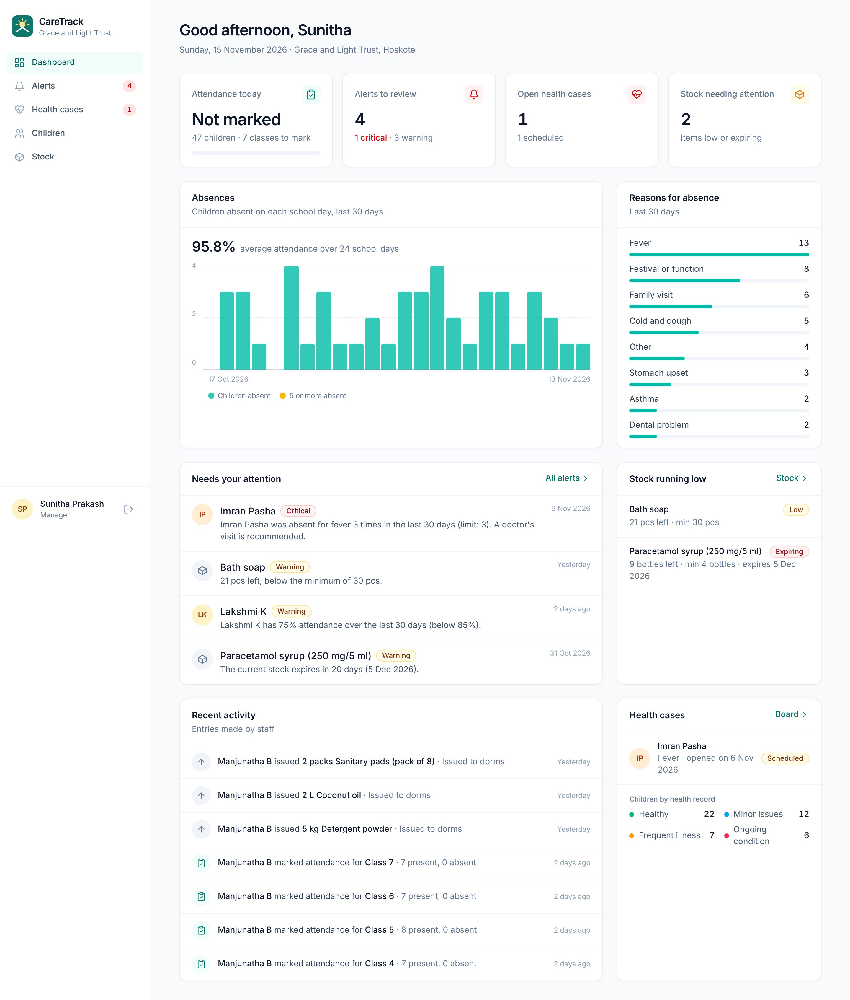 `01-dashboard-before.jpg` | Dashboard at the start of the day |
| 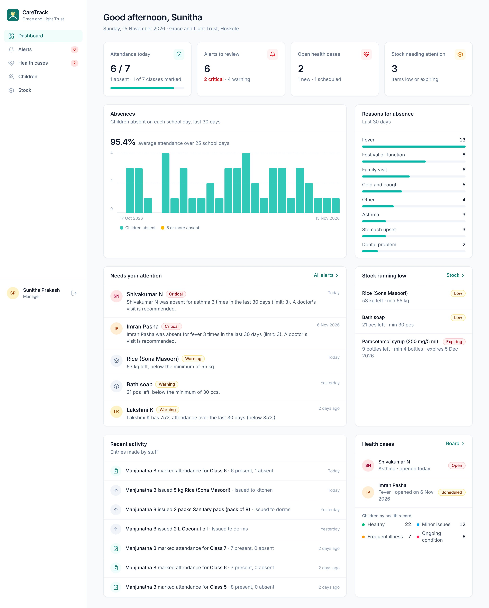 `01-dashboard-after.jpg` | Dashboard after the warden's entries: 6 alerts, 2 open cases |
| 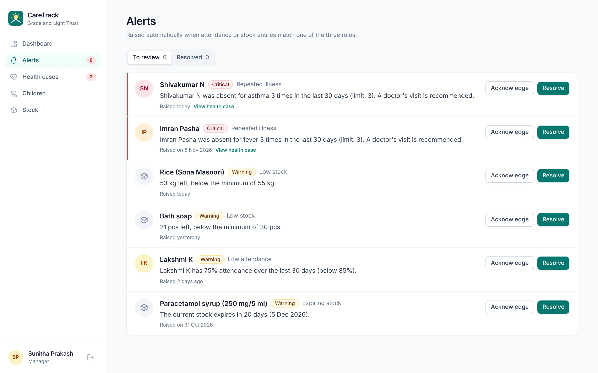 `02-alerts.jpg` | Alerts, critical first |
| 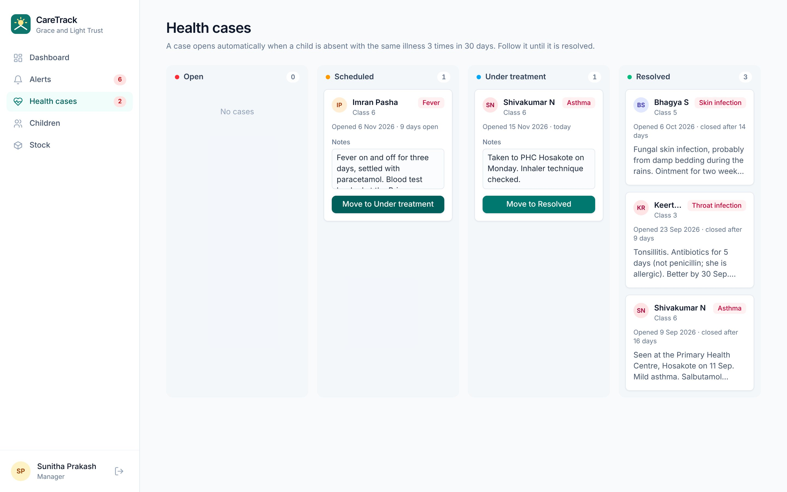 `03-health-cases.jpg` | Health cases board while a case moves along |
| 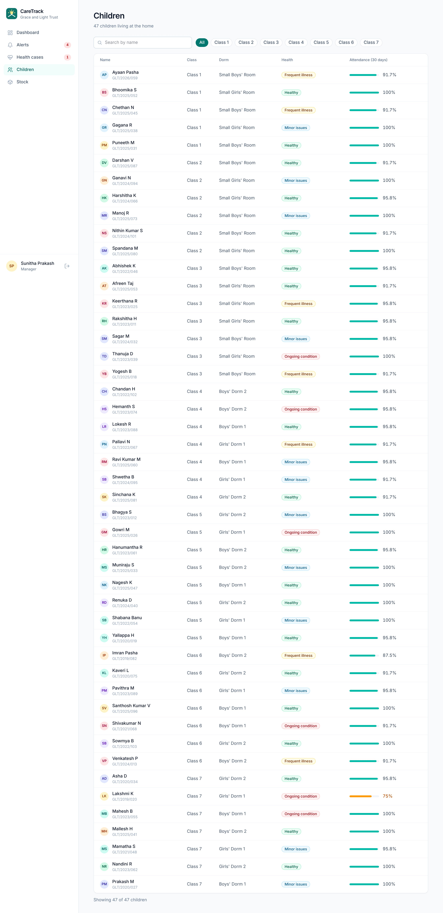 `04-children-list.jpg` | All 47 children with health group and attendance |
| 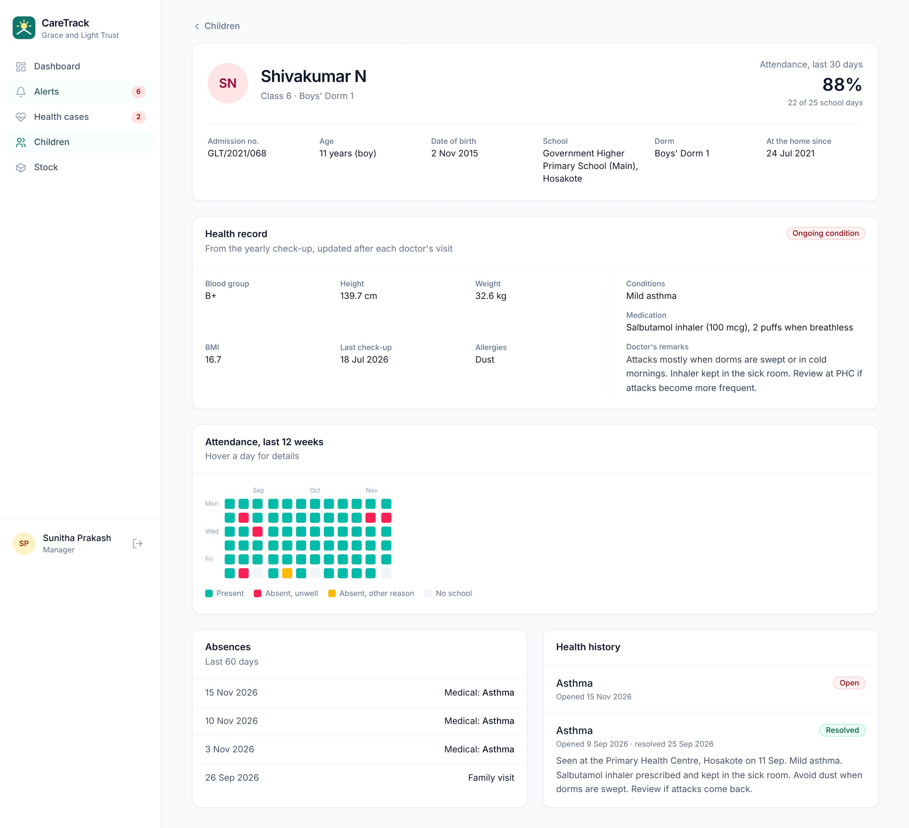 `05-child-profile.jpg` | Shivakumar N: health record, calendar, health history |
| 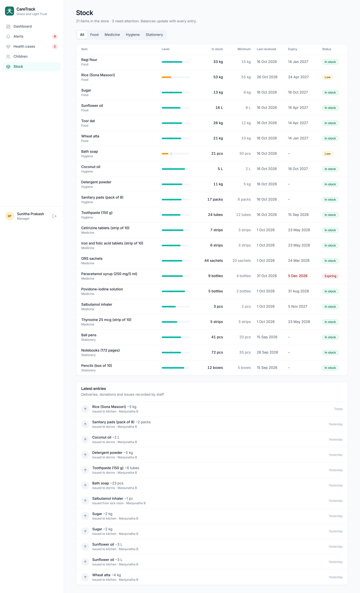 `06-stock.jpg` | Store levels against minimums, expiry, latest entries |

### Where it came from

Built with **Next.js** (React framework) and **TypeScript**, styled with
**Tailwind CSS**. The icons and logo were drawn for this project as small SVG
files. No chart or UI library is used. The layout follows common admin
dashboard patterns: summary cards at the top, details below.

### Questions to expect

- *Why server components?* The data is read on the server, so the browser never talks to the database and pages load fast on a basic laptop.
- *How does the page update after a button?* The button calls the API, then `router.refresh()` asks the server for the page again with fresh data.
- *Why no chart library?* Fewer things to install and explain; a bar chart is a few `div`s.
- *Can the manager use it on a phone?* Yes, the layout adapts, but it is designed for the office laptop.
- *What does "Children by health record" mean?* Each child's yearly check-up puts them in one of four groups: healthy, minor issues, frequent illness, ongoing condition.

---

## 2. Neha S: Warden screens (F2)

### What you own

The phone app used by the warden, Manjunatha B: sign-in, the Today screen,
attendance, stock entry and the children list. This is where every record
starts, so it has to be quick to use with one hand on a basic phone.

### Where it is in the project

| File or folder | What it is |
|---|---|
| `app/login/` | Sign-in page (phone and laptop) |
| `app/warden/layout.tsx` | Phone frame: header and bottom tabs |
| `app/warden/page.tsx` | Today: greeting, each class marked or not, store shortcuts, recent entries |
| `app/warden/attendance/page.tsx` and `components/warden/AttendanceForm.tsx` | Attendance |
| `app/warden/stock/page.tsx` and `components/warden/StockForm.tsx` | Stock used or arrived, with note |
| `app/warden/students/page.tsx` | Children list (name and room only) |

### How it works

1. **Attendance is built for speed:** everyone starts as present; the warden taps only the children who are absent, picks a reason, and the illness if it is medical. Seven classes, one tap each to switch.
2. **Checks before saving:** the form will not send if an absent child has no reason, and names the child. The server checks again.
3. **One save per class:** the whole class is sent as one request to `POST /api/attendance`. Saving the same class again the same day replaces the earlier entry, so mistakes are easy to fix.
4. **Stock:** choose Used or Arrived, the item, the quantity, an optional note ("Issued to kitchen"). The new balance comes back and is shown at once.
5. **Privacy:** the warden is told only "Saved". Alerts, health records and health cases are not on this app at all.

### What you show

1. Phone: **Today** screen: "Good afternoon, Manjunatha", all 7 classes "not marked yet".
2. Tap **Class 6** → tap **Shivakumar N** → **Medical** → **Asthma**. Point to "6 present · 1 absent".
3. **Save**: "Saved: 6 present, 1 absent."
4. **Stock** tab → **Used** → **Rice (Sona Masoori)** → **5** → tap **Issued to kitchen** → **Save**: "Rice (Sona Masoori): 53 kg now in stock."
5. **Closing (30 s):** what comes next (see the end of this guide).

### Screenshots

| Screenshot | Use it to show |
|---|---|
| 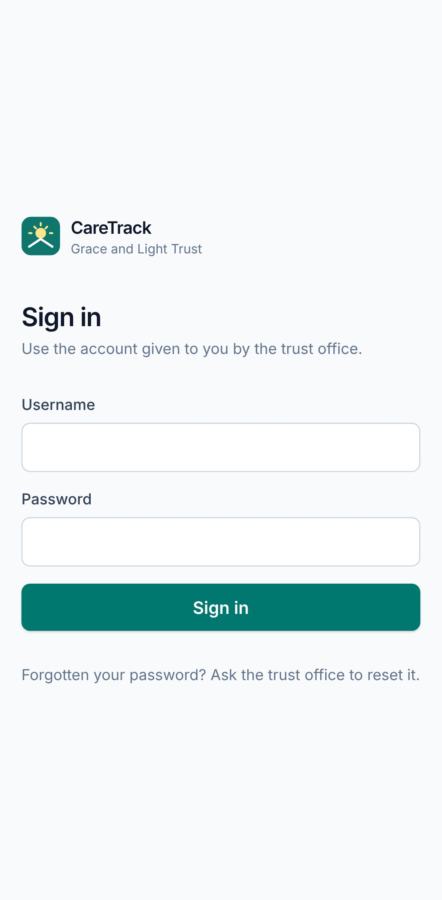 `01-sign-in-phone.jpg` | Sign-in on the phone |
| 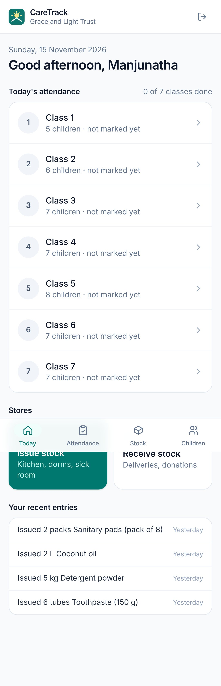 `02-today.jpg` | Today screen |
| 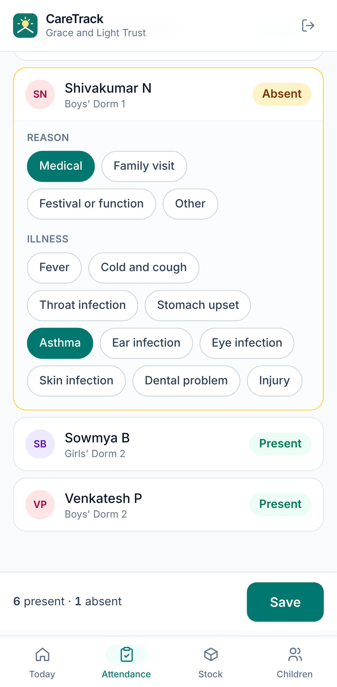 `03-attendance-marking.jpg` | Marking Shivakumar absent with reason and illness |
| 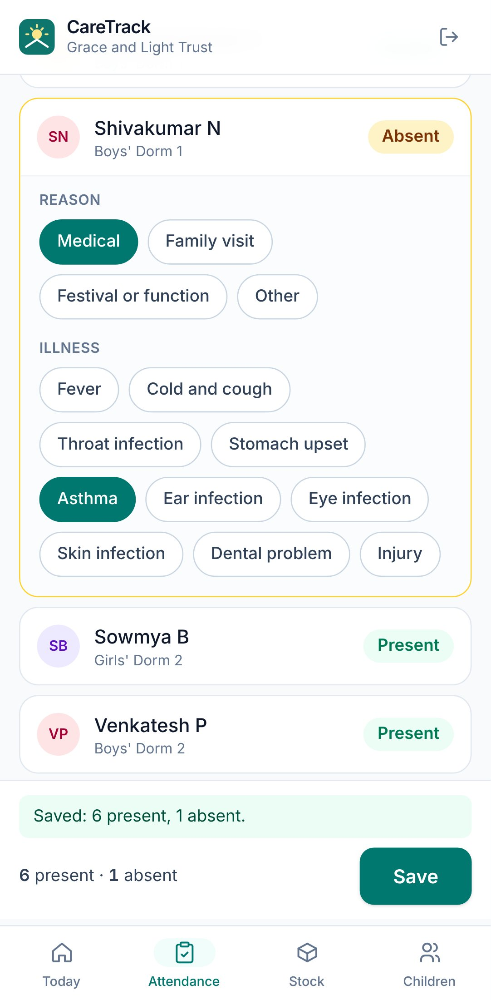 `04-attendance-saved.jpg` | Saved confirmation |
| 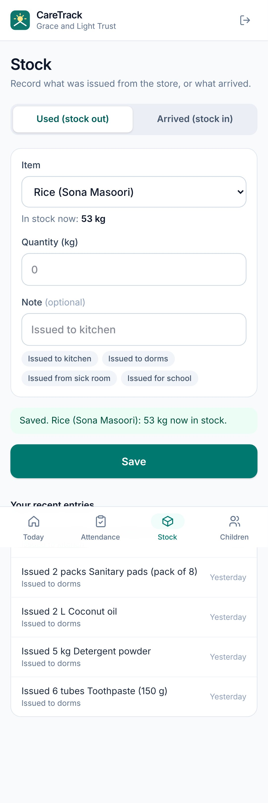 `05-stock-issued.jpg` | Rice issued to the kitchen |
| 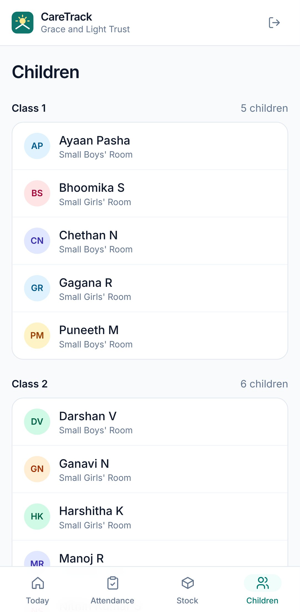 `06-children-phone.jpg` | Children list on the phone (no health data) |

### Where it came from

Same tools as the manager screens: Next.js, TypeScript, Tailwind CSS. It is a
web page designed for phones, so nothing has to be installed from the Play
Store; the warden opens it in the phone's browser.

### Questions to expect

- *What if the warden makes a mistake?* Open the class again, change it, save. It replaces the earlier entry.
- *What if they forget the reason?* The form names the child and will not save; the server would refuse it anyway.
- *Does it work without internet?* It needs the home's Wi-Fi. Offline entry is planned next.
- *Why can't the warden see alerts or health records?* Medical information is only for the manager. The server refuses it, not just the menu (Ashika's part).
- *How long does a class take?* Time it yourself on a real phone before the viva and quote your own number.

---

## 3. Joel Thomas Mario: Records and database (D)

### What you own

Where the home's information is kept and how it gets into the app: the record
files, the database design, the rules the database enforces on its own, and
the import that loads the records.

### Where it is in the project

| File or folder | What it is |
|---|---|
| `data/records/` | The home's registers as CSV files (open in Excel or Google Sheets) |
| `db/schema.sql` | The database design: 11 tables, 1 trigger, 1 view, all constraints |
| `db/import.ts` | Reads every CSV file and loads it into the database |
| `lib/csv.ts` | Reads CSV files (handles commas and quotes inside fields) |
| `lib/db.ts` | Opens the database; builds it from the records on first start |
| `scripts/reset-db.ts` | `npm run db:reset`: rebuild the database from the records |
| `data/caretrack.db` | The live database file the app uses (created automatically; not in git) |

**The record files**

| File | Rows | What it holds |
|---|---|---|
| `staff.csv` | 2 | Who can sign in, and their role |
| `children.csv` | 47 | Admission register: admission no., name, gender, date of birth, class, dorm, school, date admitted |
| `health_records.csv` | 47 | Yearly check-up: blood group, height, weight, health group, conditions, allergies, medication, doctor's remarks |
| `absence_reasons.csv` | 4 | Medical, family visit, festival or function, other |
| `illnesses.csv` | 10 | Fever, cold and cough, throat infection, asthma and others |
| `attendance.csv` | 3,525 | Daily school attendance, one row per child per school day |
| `stock_items.csv` | 21 | Store items and their minimum levels |
| `stock_entries.csv` | 513 | Every purchase, donation and issue |
| `health_cases.csv` | 4 | Health follow-ups and the doctor's notes |

### How it works

1. **Records in, as spreadsheets.** The trust keeps registers. Each register is one CSV file in `data/records/`, the format any spreadsheet can export.
2. **Import.** `npm run db:reset` runs `db/import.ts`: it creates the tables from `db/schema.sql`, then reads each file in order (staff, lists, children, health records, attendance, stock, cases), looks up each child by admission number, and inserts the rows. It all happens in one transaction: if any row is wrong, nothing is loaded and the error names the bad value.
3. **The database checks every row by itself:**
   - one attendance record per child per day (a UNIQUE constraint)
   - an absence must have a reason; a "present" row must not (a CHECK constraint)
   - stock can never go below zero (a CHECK on the balance)
   - the same alert cannot be open twice (a unique index)
4. **Stock balance is automatic.** A trigger (`stock_apply`) adds or subtracts every stock entry from the item's balance. If an issue would make it negative, the database refuses it; the warden sees "Not enough stock".
5. **After loading,** the import runs the alert rules once (Joseph's part), so the alerts are ready when the manager signs in.
6. **Storage:** SQLite keeps the whole database in one file, `data/caretrack.db`. Nothing to install and no internet account needed, which suits a small home with one laptop.

### What you show

1. `data/records/` open in the editor (or `children.csv` in Excel): "These are the home's registers."
2. `db/schema.sql`: point to `UNIQUE (student_id, date)`, the stock `CHECK (balance >= 0)` and the trigger.
3. The terminal running `npm run db:reset`.
4. The manager's **Children** page: the same 47 children, now in the app.

### Screenshots

| Screenshot | Use it to show |
|---|---|
| 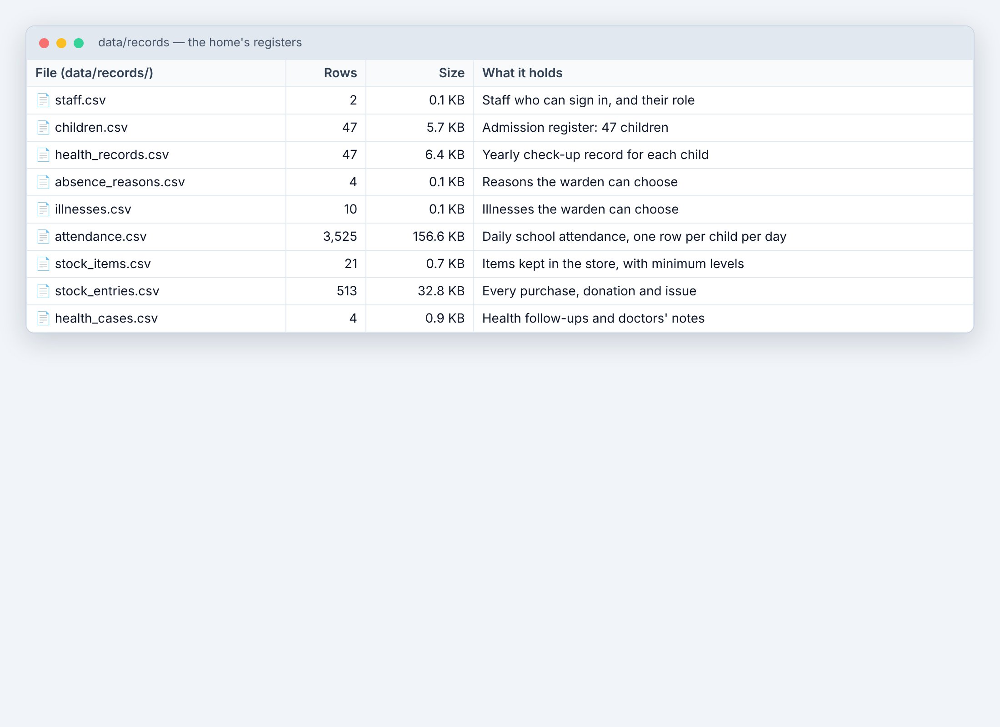 `01-records-folder.jpg` | The record files and what each holds |
| 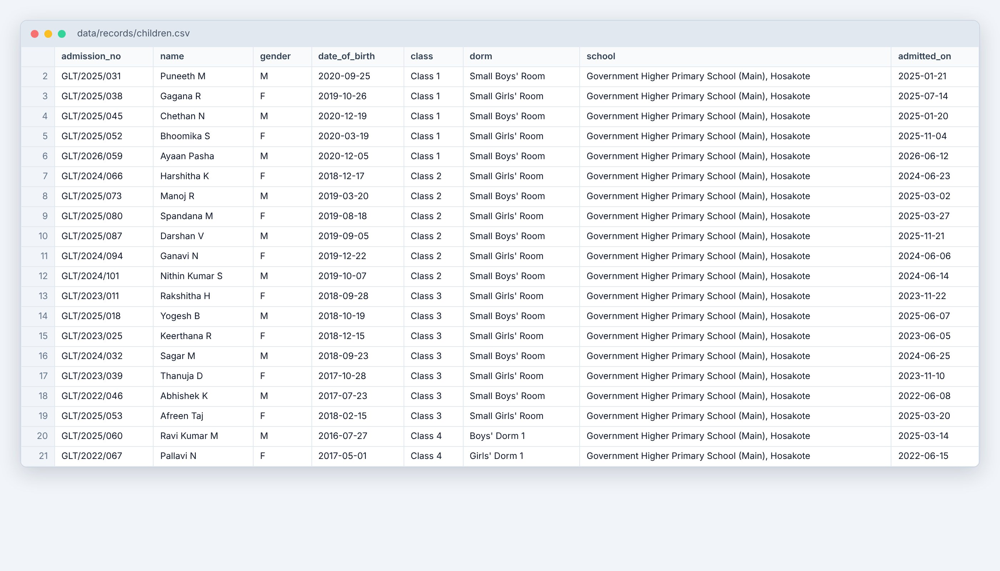 `02-children-register.jpg` | The admission register |
| 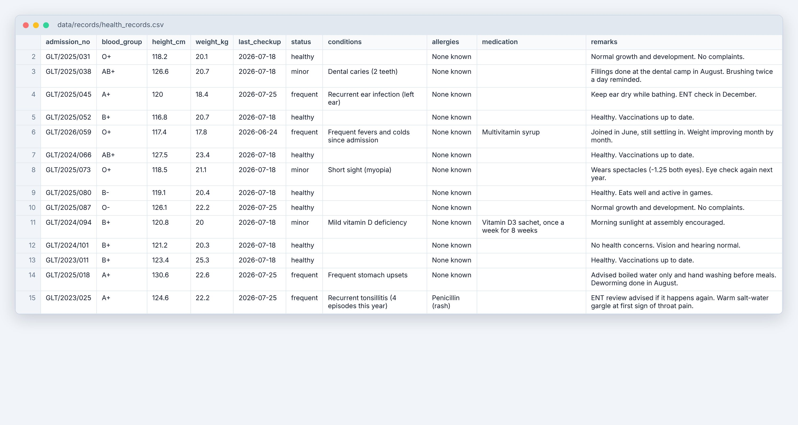 `03-health-records.jpg` | Health records from the yearly check-up |
| 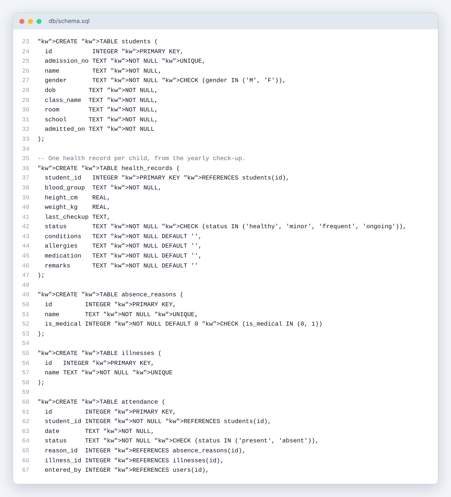 `04-schema.jpg` | Table design with constraints |
| 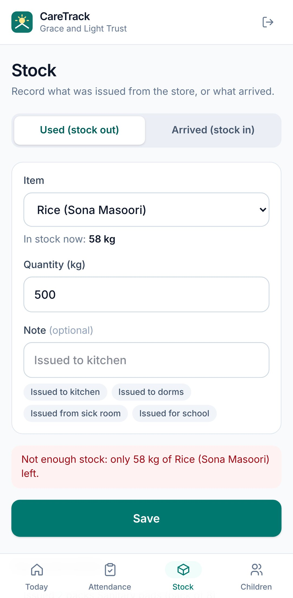 `05-database-refuses-over-issue.jpg` | The database refusing to issue more rice than there is |
| 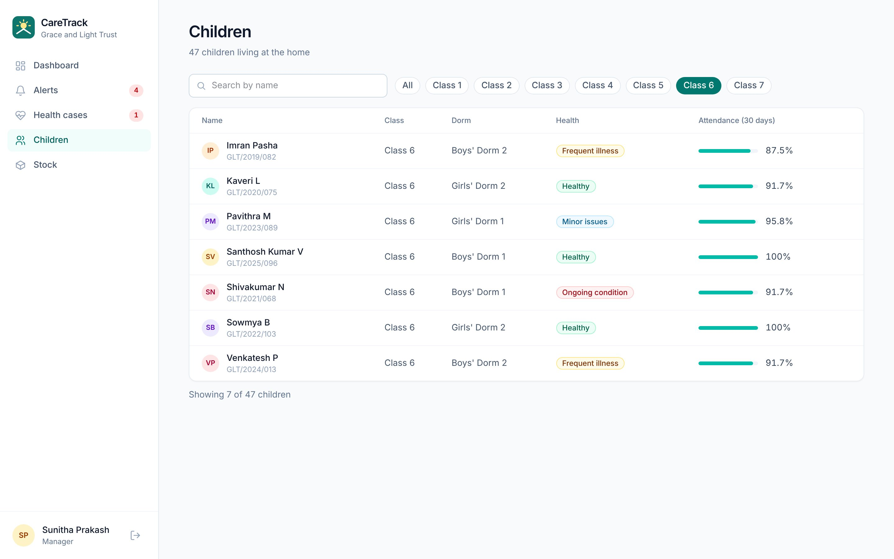 `06-children-in-app.jpg` | The records inside the app |
| 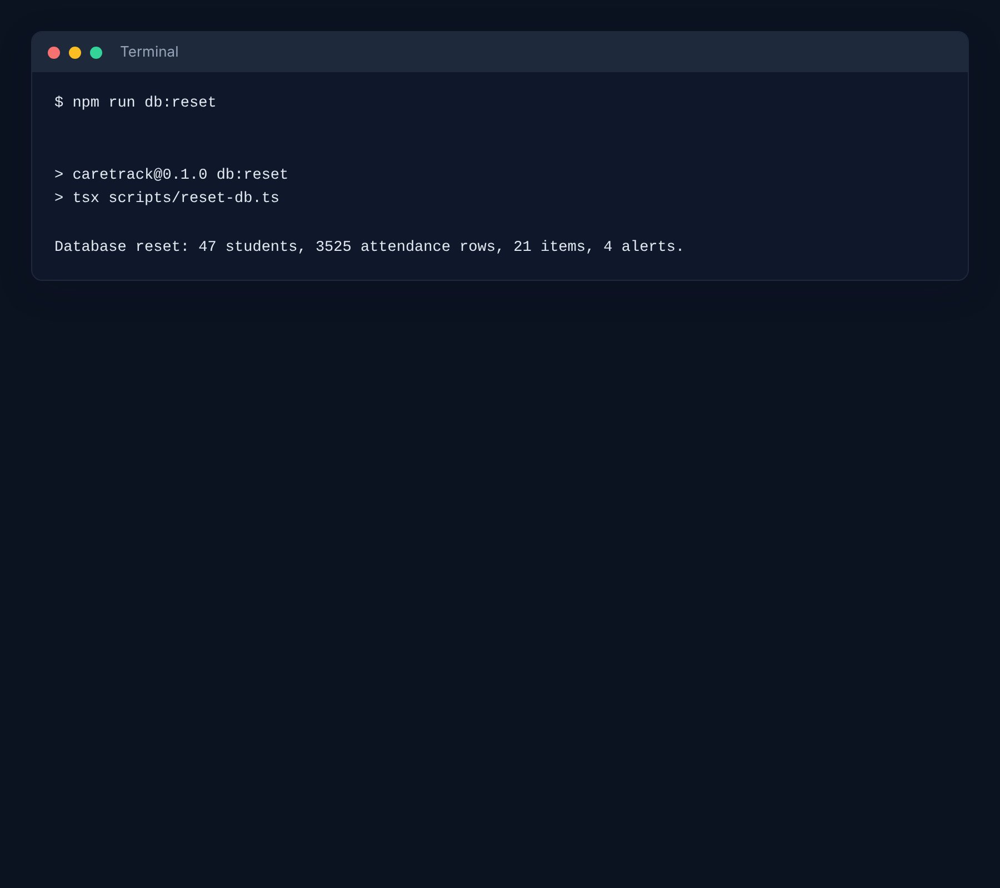 `07-import-run.jpg` | Loading the records with `npm run db:reset` |
| 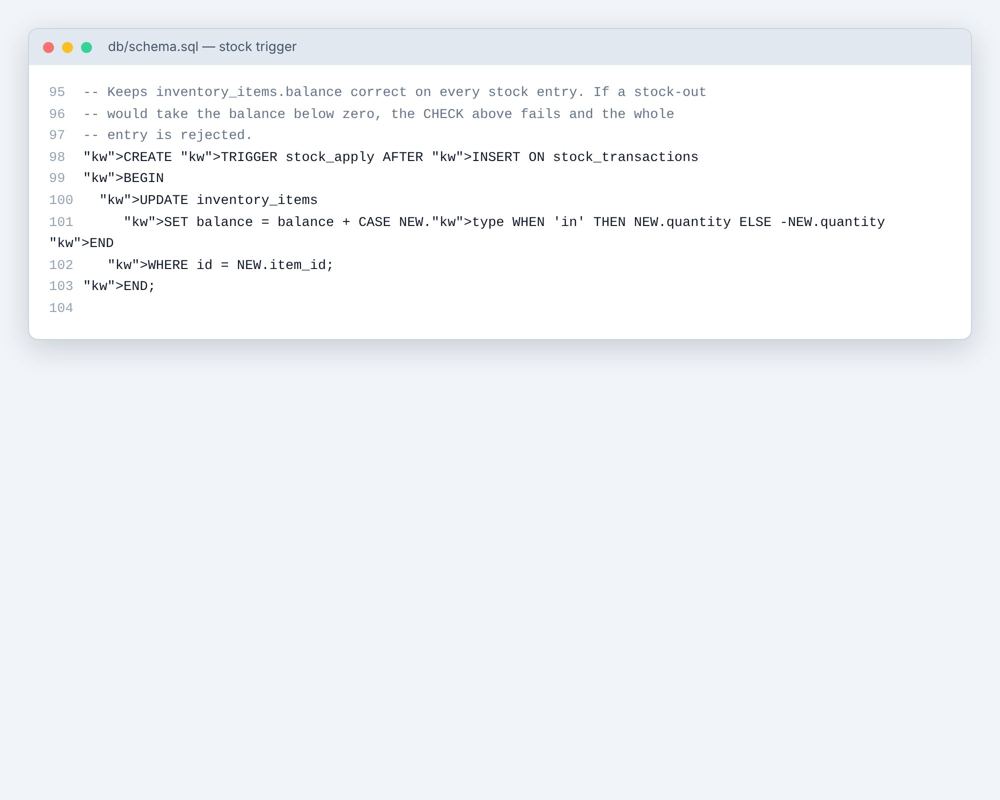 `08-stock-trigger.jpg` | The trigger that keeps stock balances right |

### Where it came from

- **The registers:** modelled on what a children's home keeps: an admission register, the yearly health check-up sheet, the daily attendance register and the store ledger.
- **The school:** all the children attend Government Higher Primary School (Main), Hosakote (Hoskote town, Bengaluru Rural district, PIN 562114), which teaches Classes 1 to 7.
- **Database:** SQLite through the `better-sqlite3` library. The schema is standard SQL and could move to PostgreSQL or MySQL unchanged.

### Questions to expect

- *Why CSV files?* That is how the trust can hand over its registers: any spreadsheet saves as CSV. New records can be added by the warden in the app; a full register can be reloaded with one command.
- *Why SQLite?* One file, no server to install, free. Right for one home and one laptop.
- *What is normalisation here?* Reasons, illnesses and items are their own tables and are referred to by ID, so "Fever" is spelt one way everywhere and the rules can count by illness.
- *What happens if a record is wrong?* The import stops, nothing half-loaded is kept, and the error names the value (for example "Unknown admission number").
- *How is the children's data protected?* The database file never goes to GitHub (`.gitignore`), and health information is only given to the manager (Ashika's part).

---

## 4. Ashika Valencia A: Sign-in, permissions and APIs (B1)

### What you own

Who can get in, what each person is allowed to see, and the 12 API routes
that the screens use to read and save data.

### Where it is in the project

| File or folder | What it is |
|---|---|
| `lib/auth.ts` | Sign-in check, sessions, `requireRole` (pages), `apiUser` (API routes) |
| `lib/password.ts` | Password hashing (scrypt with a random salt) |
| `lib/api.ts` | Reads and validates every request body (Zod) |
| `lib/queries.ts` | All the read queries the pages and routes use |
| `app/api/` | The API routes (list below) |

| Route | Who | Does |
|---|---|---|
| `POST /api/auth/login`, `POST /api/auth/logout` | Anyone | Sign in, sign out |
| `GET /api/lookups`, `GET /api/students` | Both | Lists the forms need |
| `GET /api/attendance`, `POST /api/attendance` | Both | Load a class for a day; save a class (then the rules run) |
| `POST /api/stock` | Both | Record stock used or arrived (then the rules run) |
| `GET /api/stock` | Manager | Full store table |
| `GET /api/alerts`, `PATCH /api/alerts/:id` | Manager | List, acknowledge, resolve alerts |
| `GET /api/cases`, `PATCH /api/cases/:id` | Manager | List health cases, move them forward, add notes |

### How it works

1. **Sign-in:** the password typed is checked against the stored **hash** (passwords are never stored). If it matches, a random 64-character token is saved in the `sessions` table and sent to the browser as an **http-only cookie**, which page scripts cannot read. It lasts 12 hours.
2. **Every page** calls `requireRole("manager")` or `requireRole("warden")`. Wrong role: sent to your own home page. Not signed in: sent to sign-in.
3. **Every API route** calls `apiUser(...)`. Not signed in: **401**. Wrong role: **403**. So typing an address directly does not get around the menu.
4. **Every input is validated** with Zod before it touches the database: dates must be real dates and not in the future, quantities must be above zero, IDs must exist, notes at most 120 characters. Bad input: **400** with a plain message.
5. Attendance for a whole class is checked first and then saved in **one transaction**, so it is all saved or none of it.

### What you show

1. On the phone (signed in as the warden), type `/manager/alerts`: it goes back to the Today screen.
2. On the phone, open `/api/alerts`: `{"error":"You do not have access to this."}`.
3. On the laptop, sign out and open `/manager`: it goes to sign-in. Try a wrong password.

### Screenshots

| Screenshot | Use it to show |
|---|---|
| 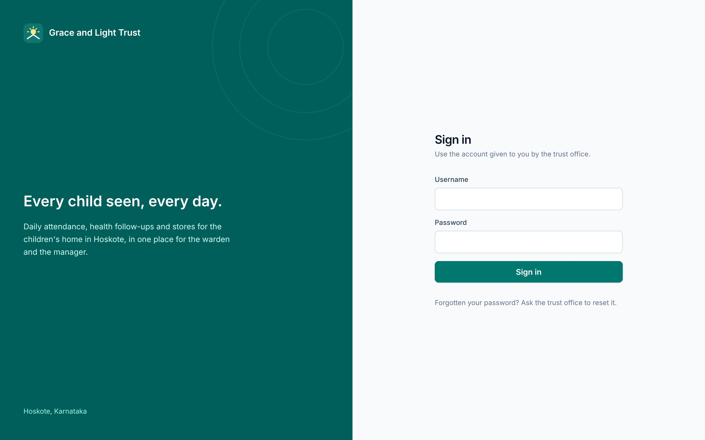 `01-sign-in.jpg` | Sign-in page |
| 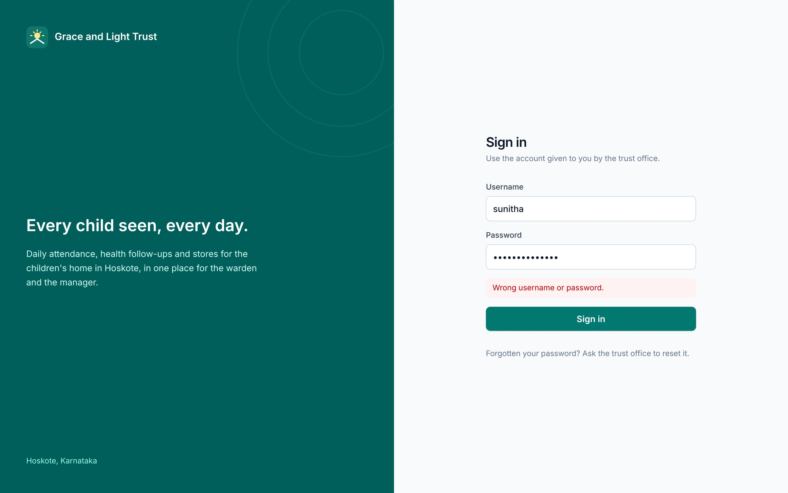 `02-wrong-password.jpg` | Wrong password refused |
|  `03-warden-refused-api.jpg` | The warden refused manager data (403) |
| 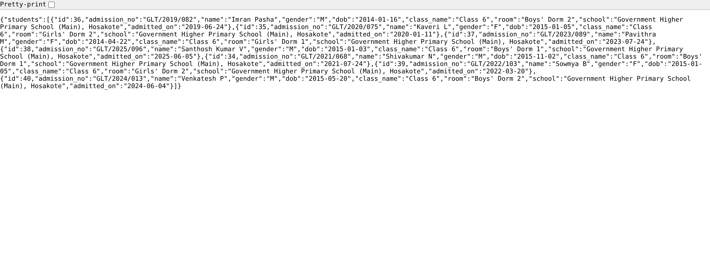 `04-api-response-manager.jpg` | What an API answer looks like (JSON) |
| 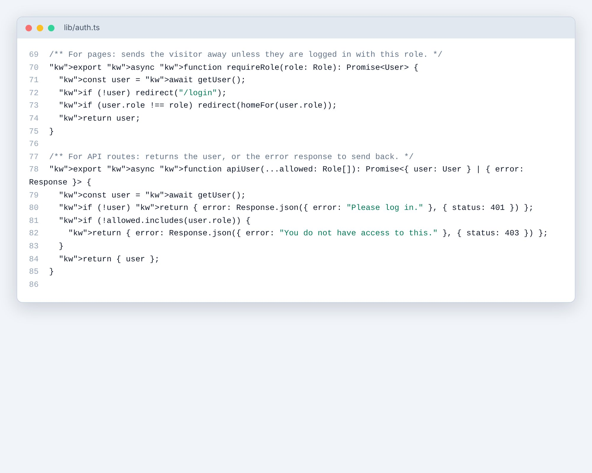 `05-role-checks-code.jpg` | `requireRole` and `apiUser` |
| 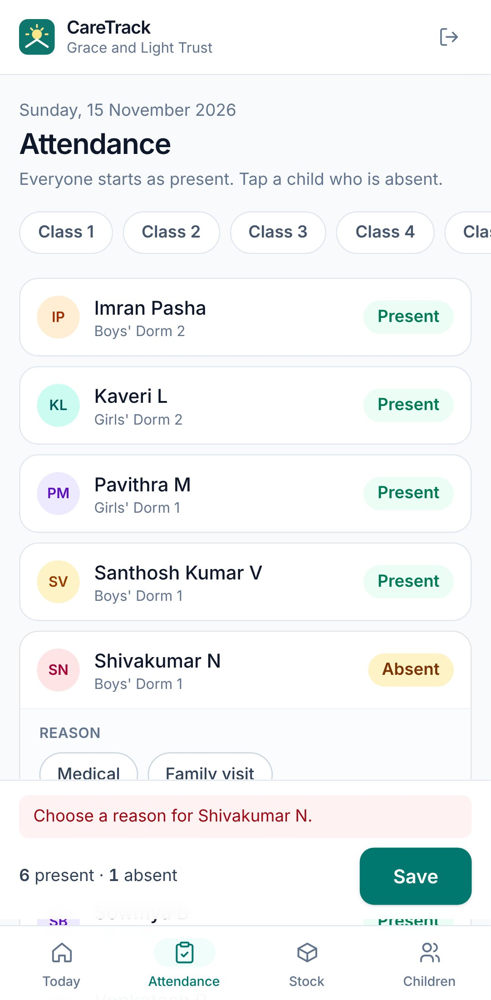 `06-validation-missing-reason.jpg` | Input checked: absence without a reason |
| 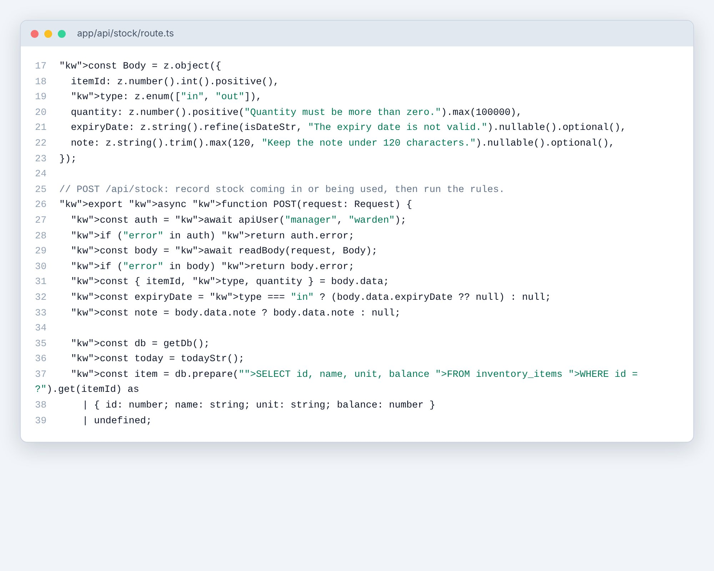 `07-input-validation-code.jpg` | The Zod rules for a stock entry |

### Where it came from

Next.js **route handlers** for the API, **Zod** for validation, Node's built-in
`crypto` module for scrypt hashing and random tokens. No third-party login
service, so it works without internet.

### Questions to expect

- *Why hash passwords?* If the database file is ever copied, the passwords cannot be read back.
- *What is an http-only cookie?* A cookie the browser sends to the server but page scripts cannot read, which protects it from being stolen by a script.
- *401 vs 403?* 401: not signed in. 403: signed in, but your role is not allowed.
- *Why check the role on the server and not just hide the menu?* Anyone can type an address. Only the server can be trusted.
- *Is it ready for the internet?* Not yet: it would need https and stronger passwords. On the home's Wi-Fi it is fine.

---

## 5. Joseph Mangali: Alert rules and testing (B2)

### What you own

The three rules that read the records and raise alerts, the code that opens
health cases, and the 50 automated tests that prove everything works.

### Where it is in the project

| File | What it is |
|---|---|
| `lib/rules/rules.ts` | The three rules as plain functions, with their limits at the top |
| `lib/rules/engine.ts` | Reads the data, runs the rules, writes alerts, opens health cases, prevents duplicates |
| `lib/rules/rules.test.ts` | 24 tests of the rules on their exact limits |
| `lib/rules/engine.test.ts` | 25 tests against the real records in a test database |
| `lib/db.test.ts` | 1 test that reloading keeps everyone signed in |

### How it works

| Rule | Fires when | Alert | Also |
|---|---|---|---|
| Repeated illness | Absent 3 or more times with the **same** illness within 30 days | Critical | Opens a health case |
| Low attendance | Below 85% over 30 days (once 10 days are recorded), or 3 school days absent in a row | Warning | |
| Low or expiring stock | Below the item's minimum, or the latest delivery expires within 30 days | Warning | |

1. The rules run **every time** attendance or stock is saved, for the children or item just saved.
2. `rules.ts` only decides ("does it fire?"); `engine.ts` reads and writes. Keeping them apart makes the rules easy to test.
3. **No duplicates:** an alert has a key such as `illness:34:5` (child 34, asthma). A new one is not created while one with that key is open, and the database enforces it too. A repeated-illness alert needs a new absence to come back; the others wait 7 days after being resolved.
4. **Wording:** an alert says what happened and the numbers, never anything about the child as a person.
5. **Tests** (Vitest) check the exact limits: 2 absences do not fire, 3 do; day 29 counts, day 30 does not; exactly 85% does not fire; a balance equal to the minimum is not low. They also load the real records into a fresh test database and replay both demo flows.

### What you show

1. "Two things just happened without anyone asking": Shivakumar's third asthma absence in 30 days, and rice dropping below 55 kg.
2. `lib/rules/rules.ts`: the limits at the top, then the repeated-illness function.
3. Run `npm test` live: 50 passed.

### Screenshots

| Screenshot | Use it to show |
|---|---|
|  `01-alerts-raised.jpg` | The two new alerts, critical first |
| 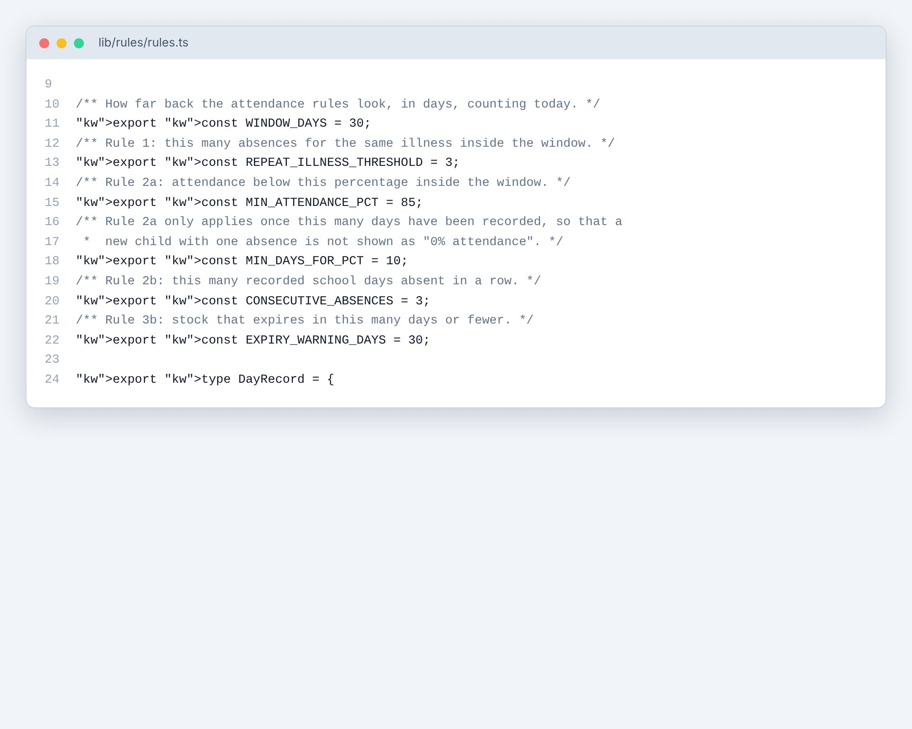 `02-rule-thresholds-code.jpg` | The limits in one place |
| 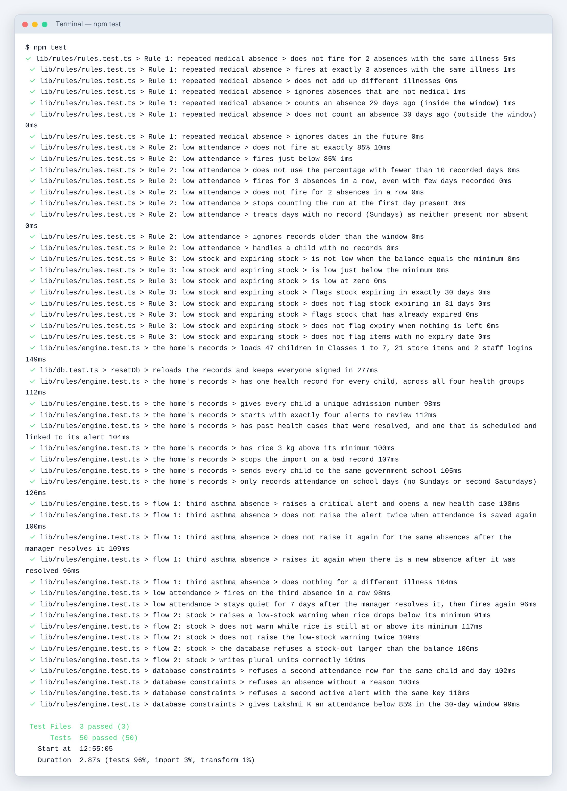 `03-tests-passing.jpg` | All 50 tests passing |
| 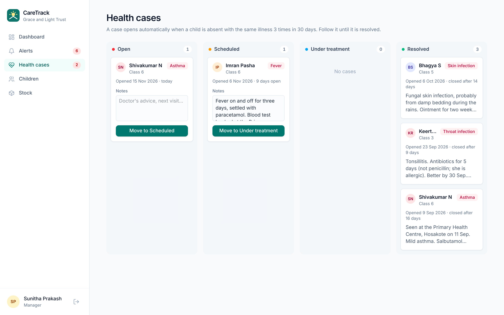 `04-health-case-opened.jpg` | Health case opened automatically |
| 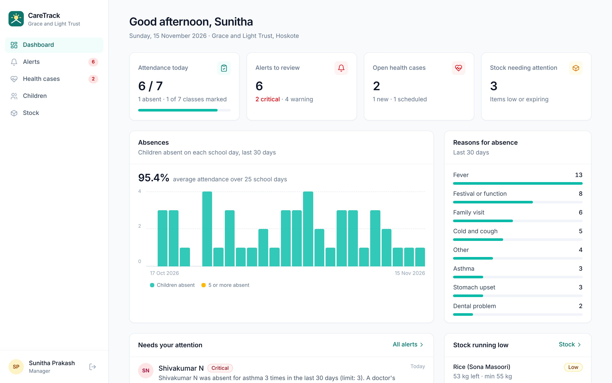 `05-dashboard-alerts-raised.jpg` | Alerts reaching the dashboard |
| 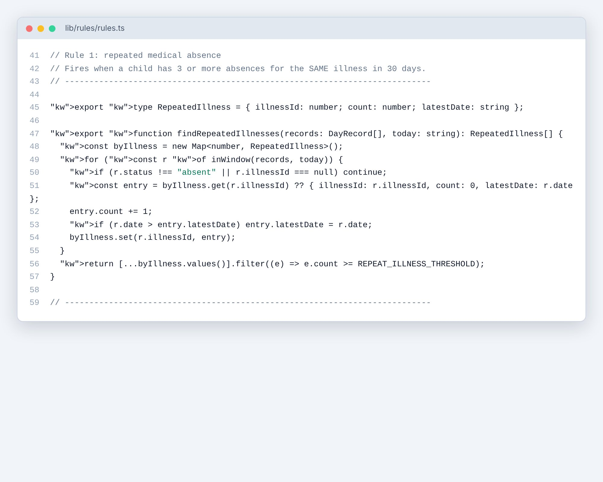 `06-repeated-illness-rule-code.jpg` | The repeated-illness rule |

### Where it came from

The limits (3 absences, 85%, 30 days) come from the project proposal. Tests use
**Vitest**. The rules are plain TypeScript with no library.

### Questions to expect

- *Why rules and not machine learning?* With 47 children there is too little data to train anything reliable, and a wrong guess about a child does harm. A rule can always be explained by pointing at the records.
- *Shivakumar had an asthma case before; why a new alert?* That case was closed in September. The rule raises it again only because there are new absences.
- *What stops the manager being flooded?* The duplicate key, and the 7-day quiet period after an alert is resolved.
- *How do you know the tests are meaningful?* Change `REPEAT_ILLNESS_THRESHOLD` to 2 and run `npm test`: the tests that check the limit fail.

---

## Closing (Neha, 30 seconds)

- We kept the three problems that matter most every day: attendance, health and stores.
- Next: try it with the warden for a week, offline entry, Kannada labels, https, and monthly reports for donors.

## Questions anyone might be asked

| Question | Answer |
|---|---|
| What technology is it built with? | Next.js and TypeScript for the app, Tailwind CSS for styling, SQLite for the database, Zod for validation, Vitest for tests. |
| Does it use AI? | The app does not; the alerts are fixed rules. We used AI coding tools while building it, which is allowed for this project. |
| Are these the real children of the home? | No. The records follow the format of the trust's registers, but they do not describe real children. Real records would be entered at the trust and are never put on GitHub, to protect the children's privacy. |
| How much does it cost the trust? | Nothing. Every tool is free and it runs on one laptop. |
| Is it online? | It runs on the office laptop and the warden's phone connects over the home's Wi-Fi. |
| What was the hardest part? | Answer for your own part, honestly. |
